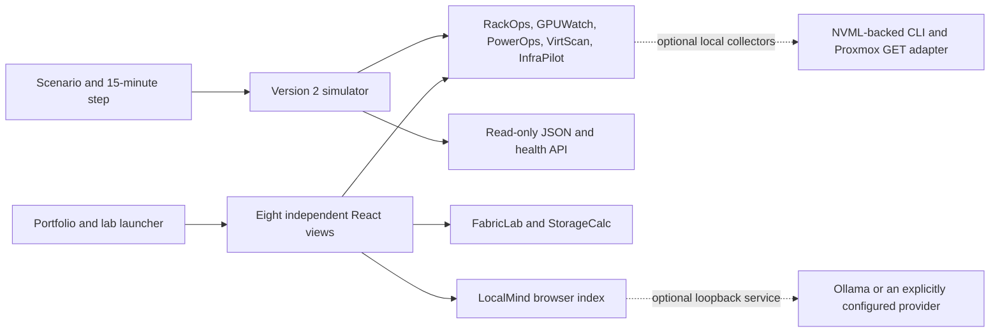

# Parag Jindal · Engineering Lab

Eight browser-based engineering demonstrations and a personal portfolio for AI infrastructure, operations, automation, network design, storage planning, and local AI. The operational apps share a fictional data centre. Every demonstration runs with its bundled data and without a hardware connection, account, or model API key.

[Portfolio](https://paragjindal.com/) · [Engineering Lab](https://paragjindal.com/lab) · [Simulator repository](https://github.com/Paragjindal01/Paragjindal01/tree/main/labs/infra-sim)

| Application | Try it | Case study and screenshot |
| --- | --- | --- |
| RackOps | [Digital twin](https://paragjindal.com/lab/rackops) | [RackOps](docs/projects/rackops.md) |
| GPUWatch | [Accelerator telemetry](https://paragjindal.com/lab/gpuwatch?scenario=critical) | [GPUWatch](docs/projects/gpuwatch.md) |
| PowerOps | [Power distribution](https://paragjindal.com/lab/powerops?scenario=critical) | [PowerOps](docs/projects/powerops.md) |
| InfraPilot AI | [Operations automation](https://paragjindal.com/lab/infrapilot-ai?scenario=critical) | [InfraPilot AI](docs/projects/infrapilot-ai.md) |
| FabricLab | [Network design](https://paragjindal.com/lab/fabriclab) | [FabricLab](docs/projects/fabriclab.md) |
| VirtScan | [Infrastructure inventory](https://paragjindal.com/lab/virtscan) | [VirtScan](docs/projects/virtscan.md) |
| StorageCalc | [Capacity and resilience](https://paragjindal.com/lab/storagecalc) | [StorageCalc](docs/projects/storagecalc.md) |
| LocalMind | [Document retrieval](https://paragjindal.com/lab/localmind) | [LocalMind](docs/projects/localmind.md) |

## Product evidence and integration

[Technical case studies](https://paragjindal.com/case-studies) pair an actual app screenshot with architecture, implementation choices, test evidence, and limitations. [Presentation integration](docs/design-integration.md) documents the data and route contracts for the future Higgsfield export. See the [public engineering benchmark](docs/engineering-quality.md), [mobile Lighthouse baseline](docs/performance-baseline.md), and [flagship cover artwork](docs/artwork/) for supporting evidence.

## RelayOps AI

[Open the offline workflow studio](https://paragjindal.com/relayops/) or see the [RelayOps source and local SQLite setup](relayops-ai/README.md). The Vercel release build bundles the browser-local version alongside the portfolio.

## Run locally

Use Node.js 22.12+ or 24 LTS.

```sh
npm ci
npm run dev
```

Open `http://localhost:5173/lab`. Each application also opens directly at its route in the table. The portfolio's contact form uses the optional `VITE_WEB3FORMS_ACCESS_KEY` from `.env.example`. Leave it unset for lab-only use. The 3D greeting at `/greeting` uses the existing Spline scene and bundled audio.

```sh
npm run lint
npm run test:unit
npx playwright install
npm test
```

The browser tests serve the production Vite build. `npm run test:chromium -- --grep-invert 'Live Spline'` runs the offline-compatible Chromium suite. The Live Spline cases require the external scene and WebGL support. The Web3Forms tests intercept delivery.

### Run in Docker

```sh
docker build -t parag-engineering-lab .
docker run --rm -p 127.0.0.1:4173:4173 parag-engineering-lab
```

Open `http://127.0.0.1:4173/lab`. The container includes the browser demos and read-only simulator API. Optional CLI adapters are documented in their case studies.

## Architecture



React and Vite serve the independently routed applications. The shared JavaScript simulator returns deterministic, versioned inventory and telemetry. Vercel provides direct navigation and the JSON function. See the [API and scenario contract](docs/simulator-api.md) for supported requests, units, and thresholds.

## Security and development status

The public demos ship fictional inventory, source documents, reserved IPs, and locally administered MACs. The simulation API is GET-only. Power actions require a demo operator and a confirmed, expiring action token. They change in-memory simulator state and produce a session audit record. InfraPilot tools validate inputs and results and remain read-only. Its reviewed handoff opens PowerOps for a separate control decision.

LocalMind keeps files and retrieval in browser memory by default. The optional loopback model service is off by default. An explicitly selected external model receives the query and selected context. Proxmox access is a separately configured inventory-only CLI. It uses HTTPS, a locally supplied read-only token, and a fixed API path. The public browser does not run that collector.

The current release is a set of interactive portfolio MVPs. Persistent operational data, multi-user authentication, hardware control, and production monitoring are outside the lab. The simulator in the profile repository retains its original v1 CLI alongside the v2 contract. Consult individual case studies for measured scope and model, rendering, and hardware integration limits.
