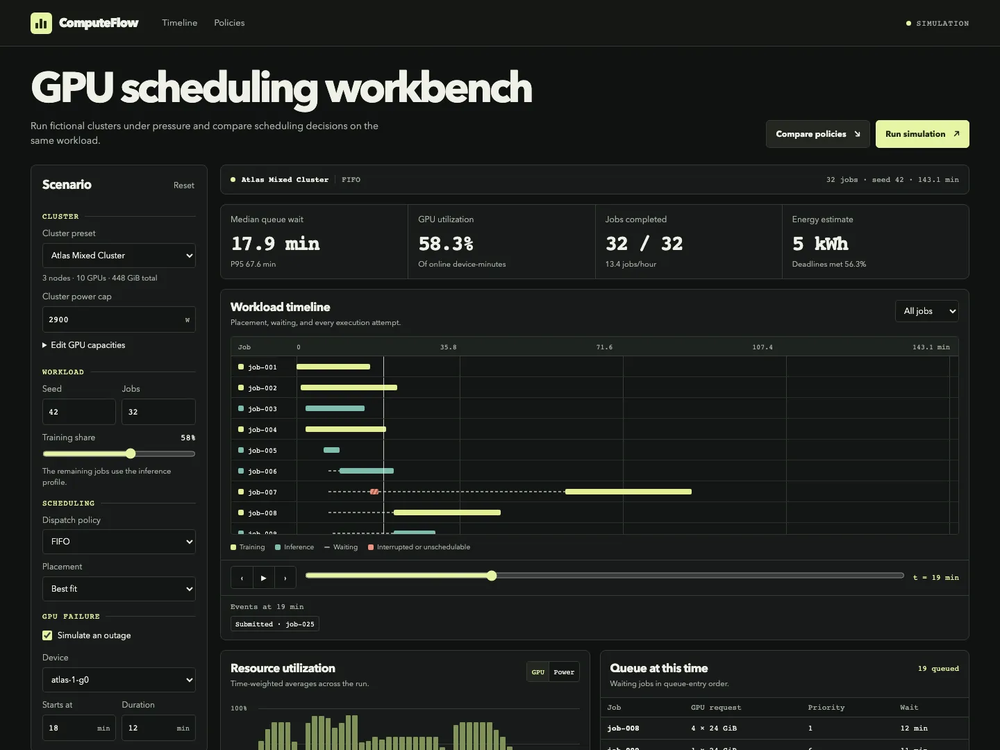

# ComputeFlow

ComputeFlow is an interactive GPU scheduling workbench. Run identical workloads against different queue policies, inspect why work waited or restarted, and measure the trade-offs before changing the simulated cluster.

[Live workbench](https://paragjindal.com/compute-flow/) · [Technical case study](https://paragjindal.com/case-studies/compute-flow) · [Benchmarks](docs/benchmarks.md) · [Engine design](docs/architecture.md)



## Run locally

Requires Node.js 22.12 or later.

```sh
npm ci
npm run dev
```

Open the URL printed by Vite. To build and serve static files locally, run `npm run build` followed by `npm run preview`. Use `npm run build -- --base=/compute-flow/` when serving the static application from that subdirectory.

## Try a scheduling experiment

1. Choose a fictional GPU cluster and inspect device capacities. Adjust the cluster power budget or device configuration.
2. Set the workload seed and job count. Add a simulated GPU outage to see jobs interrupt and recover.
3. Run a policy. Use the timeline and queue view to inspect submissions, allocations, completions, and GPU faults at a chosen time.
4. Compare queue policies on the same inputs. Review the measured result and the optional policy recommendation. The recommendation explains a scoring rule applied to the simulation and runs locally.

Queue policy, GPU placement, and backfilling are separate concepts. FIFO and priority choose what to consider first. Fair share uses prior team service. Best-fit aims to preserve more suitable GPUs for larger requests. Conservative backfilling can schedule a later job while preserving the blocked head job's forecast start. Multi-GPU jobs acquire their full allocation at the same time on one node.

## Verify and benchmark

```sh
npm test
npm exec playwright install chromium firefox webkit
npm run test:browser
npm run benchmark
npm run benchmark -- --json
```

The public workbench performs the simulation in the browser with fictional hardware and workloads. The engine is also a standalone JavaScript module and does not require a web server, credentials, a model provider, or a GPU. See the [model assumptions and metrics](docs/architecture.md) before interpreting scheduling results.
