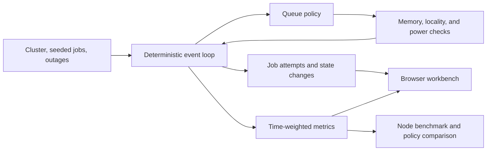

# ComputeFlow engine design

## Simulation model

ComputeFlow jumps from event to event in simulated minutes. It models job arrivals, allocations, completions, device failures, and restoration. The clock rounds to one millionth of a minute and uses that as the minimum execution duration. Stable event and queue tie-breaks make runs reproducible. Every job gets exclusive use of its GPUs during an attempt. A job has a required memory amount on each device and acquires all of its GPUs on one node. Its processing rate is the device count multiplied by the slowest allocated device's compute rate. The amount of work stays constant across policies and retry attempts.

The power limit applies to GPU draw. Online idle devices consume their idle rating, running devices consume their active rating, and unavailable devices consume zero modeled power. Admission reserves an offline GPU's idle draw so its repair cannot break the cap. If an outage affects a multi-GPU job, the entire allocation is released. Retryable jobs rejoin the queue with full work remaining. Busy time and energy spent on interrupted attempts still count. A simultaneous completion is processed before repairs, faults, arrivals, and dispatch. The run ends when every submitted job has reached a terminal outcome.

FIFO uses ready order. Priority puts higher declared priorities first. Fair share gives preference to teams with lower accrued service-to-demand ratios and fewer GPUs currently in flight. First-fit scans in stable input order. Best-fit favours tighter-capacity placements using a bounded, deterministic heuristic. A suffix minimum-watt table finds a viable crew without enumerating combinations. Backfill only starts a lower-ranked job when it can preserve the head job's forecast start based on current allocations and known repairs. Future arrivals and outages can change that forecast. The policies are inspired by documented scheduling concepts. [Slurm Scheduling Configuration Guide](https://slurm.schedmd.com/sched_config.html) · [Slurm Multifactor Priority](https://slurm.schedmd.com/priority_multifactor.html)

## Metrics

- **Queue wait** totals the intervals a completed job spent ready and waiting, including retries. **Turnaround** measures submission to completion. Both use linear interpolation at rank `(n − 1) × percentile`. Failed and infeasible jobs remain visible in their own outcome totals.
- **Utilization** divides integral busy GPU-minutes by integral online GPU-minutes. **Throughput** reports completed jobs per simulated hour.
- **Deadline completion** divides on-time completions by the number of jobs with deadlines.
- **Fragmentation** divides unusable idle GPU-minutes by all idle GPU-minutes while jobs are queued. A GPU is usable when it can participate in a complete feasible queued allocation on its node under the power cap.
- **Energy** integrates modeled GPU watts across event intervals and converts watt-minutes to kWh.
- **Fairness** uses Jain's index across teams' ratios of allocated to demanded GPU-minutes. Demand includes queued and running work. The formula is `(sum of ratios)² / (team count × sum of squared ratios)`. Teams with zero simulated demand are excluded. [Jain, Chiu, and Hawe](https://arxiv.org/abs/cs/9809099)

The optional recommendation ranks measured policy results using completion (30%), deadlines (26%), p95 wait (19%), fairness (15%), and energy (10%). Wait and energy are normalized to the compared policies. If no policy completes a job, it offers no recommendation.

## Boundaries

The experimental units are jobs and GPUs. The model omits fabric latency, CPU and host power, heterogeneous collective overhead, checkpoint recovery, shared devices, and real hardware control. Results are deterministic estimates for the configured inputs. They can inform a policy comparison within the model.
