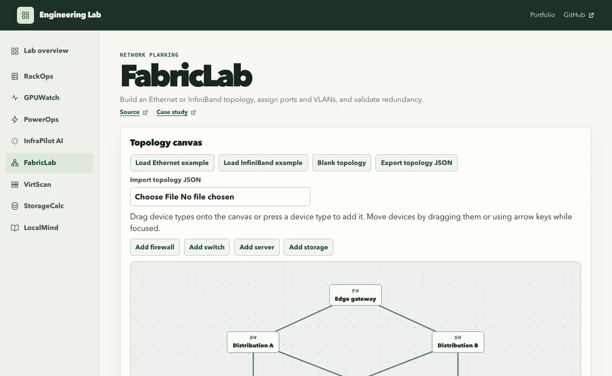
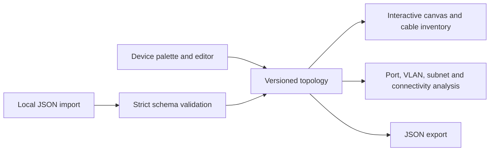

# FabricLab

FabricLab is a browser-based network planner for fictional Ethernet and InfiniBand deployments. Place devices with the mouse, touch controls, or the keyboard. Build cables, define access and trunk VLAN assignments, and inspect port reuse, subnet overlap, aggregate link capacity, and single-cable failure results.

## Run

From the portfolio root, run `npm ci` and `npm run dev`, then open the engineering lab and choose FabricLab. Run its domain tests with `node --test src/lab/apps/fabric.test.mjs`.

## Architecture

The React canvas uses positioned HTML controls and SVG links. The two example topologies use fictional nodes and documentation IPv4 ranges. Validation checks the topology schema before loading an import. The connectivity calculation removes each cable in turn and checks whether a server or storage node can still reach a firewall, or any switch if there is no firewall, on a continuous fabric.

### Cable outage drill and design report

Choose a cable to model its outage without editing the design. FabricLab compares endpoint reachability before and after the failure, distinguishes newly isolated devices from pre-existing gaps, and reports aggregate remaining link rates. Export the versioned design report to include the original topology, validation findings, modeled outage, and analysis assumptions.

For example, in the bundled Ethernet topology, remove cable 5 and then simulate the loss of cable 2. Compute 01 loses its route to the gateway and 175 Gbps of installed link capacity remains.

## Security and limits

The application performs its calculations locally and makes no network connections. It limits import size and renders imported labels as text. Exported topology JSON can contain whatever the visitor enters. Single-cable analysis covers graph reachability. It does not model protocol forwarding, spanning tree, gateway redundancy or subnet reachability. Aggregate cable capacity is the sum of installed link rates.

**Status** Functional browser MVP.

## Verification

The domain test verifies that outage analysis leaves the graph intact and separates new failures from previously isolated endpoints. The browser check verifies the exported values and remaining cable count. These browser checks passed in Chromium, Firefox, and WebKit.
