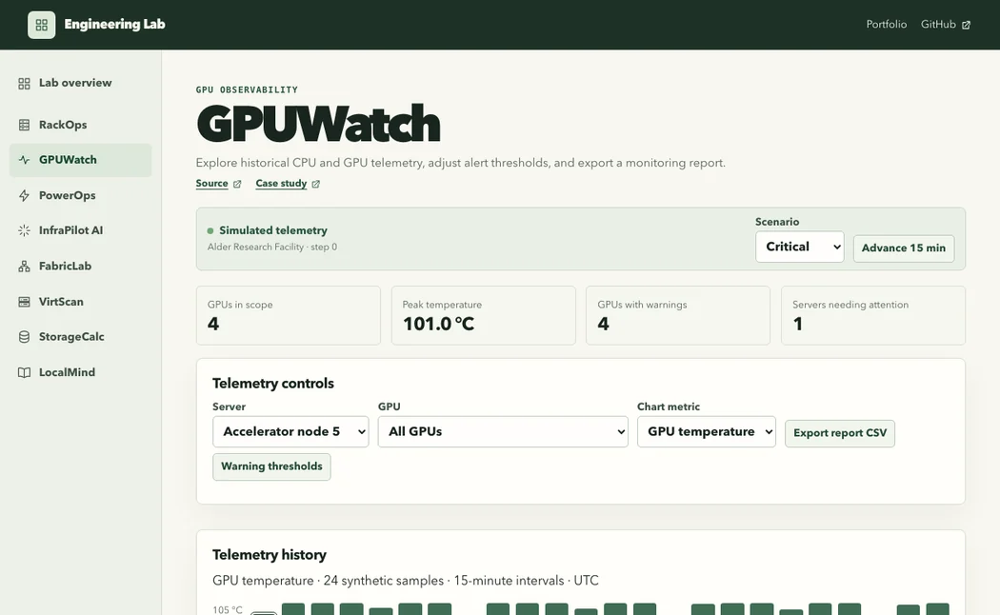
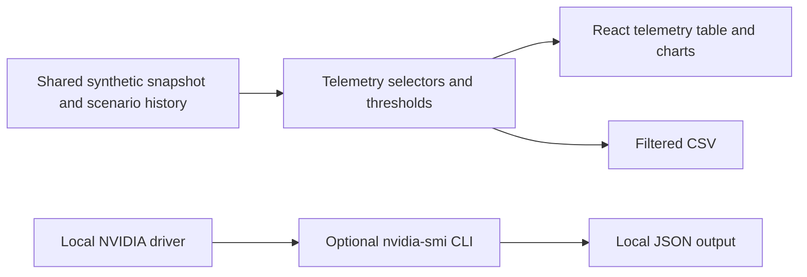

# GPUWatch

[Conceptual cover artwork](../artwork/gpuwatch.webp)

GPUWatch is a portfolio MVP for inspecting a synthetic GPU fleet. Four servers provide individual GPU metrics, while system CPU, memory and power are attributed to the host. A scenario changes workload and cooling conditions, and the per-GPU table shows threshold breaches.

## Run and try

From the repository root, run `npm ci` and `npm run dev`, then open `http://localhost:5173/lab/gpuwatch`. Choose **Critical**, select a server and a GPU, and use **Warning thresholds** to see how alerting responds to different limits. **Export report CSV** downloads the current filtered metrics and warning names.

Run `node --test src/lab/apps/operations.test.mjs` for telemetry and adapter unit tests. `npx playwright test tests/lab-operations.spec.js --project=chromium` exercises the app in a browser.

## Architecture

React and Vite serve the browser app. The shared JavaScript simulator produces deterministic samples at 15-minute intervals. Historical GPU utilization, VRAM, CPU, memory and temperature show averages within the selected scope. Historical power sums each selected GPU server once. The detail table lists each GPU temperature individually so an average cannot hide a hot device there. **Threshold exposure** applies the current filters and warning limits across the scenario window. It reports per-GPU warning counts, the longest consecutive sample streak, peak temperature, and the last warning timestamp. Streaks count samples rather than continuous time.

## Optional NVIDIA telemetry

On a personally authorized local computer with an NVIDIA driver, run `node tools/gpuwatch-nvml.mjs` to collect local GPU utilization, temperature, memory and board power through NVIDIA's NVML-backed `nvidia-smi` query mode. Unsupported metrics appear as `null`. The CLI prints JSON locally. [NVIDIA Management Library](https://developer.nvidia.com/management-library-nvml) and [NVIDIA System Management Interface](https://docs.nvidia.com/deploy/nvidia-smi/index.html)

## Security and limits

The public app runs with synthetic hardware and no external credentials. Warning thresholds apply to the browser session. The optional CLI and browser run independently, and local GPU telemetry stays in the CLI output. The CLI parser is covered by fixtures. Verification against a physical NVIDIA device and integration with a persistent metrics store remain open.
