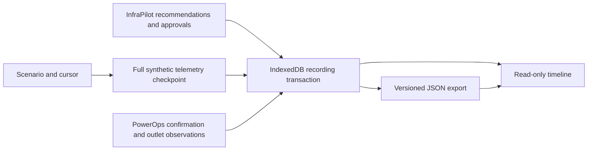

# InfraPilot AI incident replay

[Open the recording panel](https://paragjindal.com/lab/infrapilot-ai#incident-replay) · [InfraPilot AI case study](infrapilot-ai.md)

Start a recording, change the simulator scenario or advance its clock, and run an infrastructure query. A recording captures the full version 2 telemetry checkpoint, followed by the structured tool output and recommendations. Prepare and review a simulated handoff to capture its proposal and decision. PowerOps actions on the linked outlet carry the same handoff ID and include the observations before and after confirmation. Completed reboots are recorded when observed in the PowerOps tab.

Open the timeline to play, step, scrub, or jump to an event. Each event records its position, UTC wall time, source, simulated scenario, and step. A reviewer can inspect the historical telemetry, recommendations and decisions at that position without regenerating the simulation or executing an action. Export JSON to share a read-only copy. Stop a recording to close it explicitly. Until stopped, the original browser can resume it after a reload.

## Run and verify locally

From the portfolio checkout, run `npm ci` and `npm run dev`. Visit `/lab/infrapilot-ai#incident-replay`. Run `npm run test:unit` and `npx playwright test tests/incident-replay.spec.js` for archive contract and end-to-end coverage.

## Scope and security

The recording runs in the current browser. It captures synthetic simulator data and validated rule results. It excludes raw query text and optional model-generated summaries. It keeps up to 20 local recordings and 200 events or 6 MiB per archive. The storage transaction assigns event order and retains a slot to stop a recording. A matching approved handoff can attach PowerOps evidence to an open recording; the existing PowerOps operator and confirmation checks authorize any simulated action independently.

Imported files are data only. They remain in browser memory, cannot reopen a recording or authorize an action, and receive strict format, sequence, context, and size checks. Browser-local recordings can be cleared through browser data settings. An exported trace has no signature or external time attestation. The replay is suitable for demonstration and review of the recorded actions, with no shared or compliance-grade audit storage.
