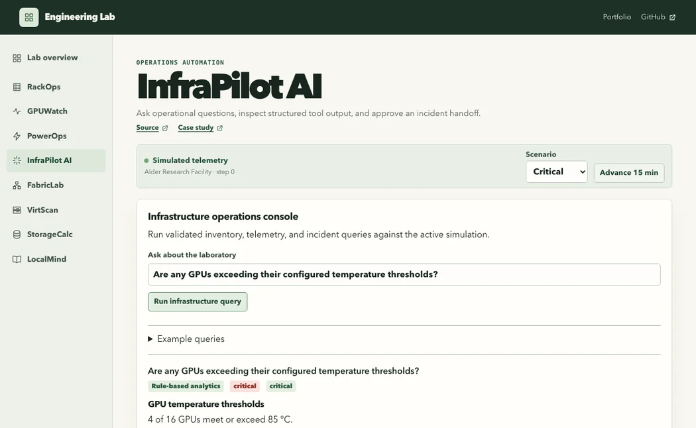
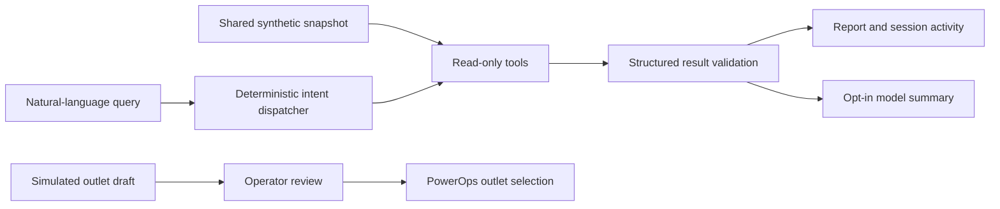

# InfraPilot AI

InfraPilot turns natural-language infrastructure questions into validated, read-only analytics over a fictional facility. Select the critical scenario to see related host, accelerator, thermal and power alerts in one report.

[Open the engineering lab demo](https://paragjindal.com/lab/infrapilot-ai)



## Run locally

From the portfolio root, use `npm ci` and `npm run dev`, then open [the local demo](http://localhost:5173/lab/infrapilot-ai). The offline path needs no model, key, hardware or additional service. Try asking which GPUs exceed their thresholds and schedule a health report every 15 seconds.

Run the tool and adapter tests with:

```sh
node --test src/lab/apps/ai-apps.test.mjs tools/lab-ai.test.mjs
npx playwright test tests/lab-ai.spec.js --project=chromium
```

## Architecture



The React UI executes plain JavaScript tool functions against the shared normal, warning, critical and recovery fixtures. The tool registry covers normalized inventory, server health, GPU temperature, rack environment, rack power, PDU and outlet utilization, incident classification, utilization comparison and compute headroom. A report combines tool outputs, deduplicates recommendations and can be reopened or exported as JSON. The report workflow reuses the same validation and analytics as interactive queries.

The handoff validates the target outlet and operation, records a five-minute request and requires explicit approval under the simulated operator role. The link selects the outlet in PowerOps. PowerOps has its own role, action confirmation and audit history.

## Optional local model

Start Ollama on the same machine and install a model, such as `ollama pull qwen2.5:3b`. Copy `tools/lab-ai.env.example` to `tools/lab-ai.env.local`. Start the adapter with `node --env-file=tools/lab-ai.env.local tools/lab-ai.mjs`. In a separate terminal run `VITE_LAB_AI_ENDPOINT=http://127.0.0.1:8765 npm run dev`, open the configured localhost origin and select Local Ollama. The model receives the validated result and supplies a separately labelled summary.

To enable an external OpenAI-compatible provider, configure all three server-side external variables and start Vite with `VITE_LAB_AI_EXTERNAL=1` in addition to the endpoint variable. Selecting that provider and submitting a query shares the question and result with the configured destination. Keep the key in the ignored local service file.

## Status and security

- Offline simulator MVP with rule-based intent matching and deterministic analytics. Queries outside the tool vocabulary return an explicit unsupported-query message.
- Model integration uses a separate Node process bound to loopback with exact Host and Origin checks, request limits and validated responses. Models have no infrastructure tool or control access. The adapter tests use mocked responses. Live model inference remains unverified because this environment has no Ollama installation or configured external provider.
- Schedules and audit display are tab-scoped. Browser suspension can delay a run, and closing the tab clears its history. The demo role models an authorization step for the handoff.
- All inventory, metrics and actions in the application are synthetic.
