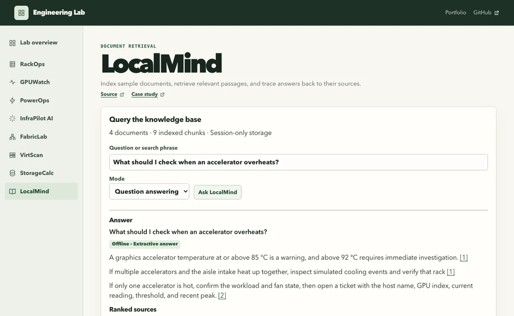
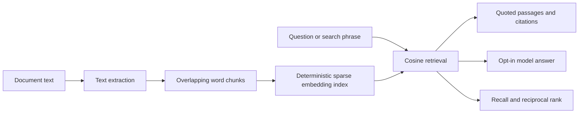

# LocalMind

[Conceptual cover artwork](../artwork/localmind.webp)

LocalMind is a private, in-browser document assistant with semantic passage search, question answering, source citations and retrieval evaluation. The sample library contains original fictional infrastructure runbooks.

[Open the engineering lab demo](https://paragjindal.com/lab/localmind)



## Run locally

From the portfolio root, use `npm ci` and `npm run dev`, then open [the local demo](http://localhost:5173/lab/localmind). Run the sample evaluation or ask what to check when an accelerator overheats. Add a fictional TXT, Markdown or HTML file to try the ingestion and indexing workflow.

Run the retrieval and adapter tests with:

```sh
node --test src/lab/apps/ai-apps.test.mjs tools/lab-ai.test.mjs
npx playwright test tests/lab-ai.spec.js --project=chromium
```

## Architecture



The React application extracts text from an inert HTML template or reads plain TXT and Markdown, splits words into configurable overlapping chunks and builds normalized sparse vectors in browser memory. Term weighting, adjacent word pairs and an infrastructure vocabulary map make related operational language searchable. Cosine ranking filters weak candidates. Extractive answering ranks relevant sentences from the returned passages and cites their chunk IDs. The evaluation pane compares expected documents to the top three results and reports recall and mean reciprocal rank. With the default corpus and chunk settings, the bundled four-question evaluation reaches 100% recall@3 and 0.875 mean reciprocal rank.

### Candidate index comparison

Expand **Compare chunk settings** to benchmark a candidate index on the same corpus and labeled queries. The comparison shows chunk counts, recall@3, mean reciprocal rank, and per-query rank changes. The ephemeral candidate never replaces the active index. A JSON export includes settings and rank results, without document contents.

On the bundled four-query suite, changing from 70 words with 12 words of overlap to 120 words with 20 words of overlap reduces the chunk count from 9 to 5, with 100% recall@3 and 0.875 mean reciprocal rank on both. The screenshot uses a 30-word candidate with 20 words of overlap. It indexes 38 chunks and improves mean reciprocal rank to 1.000. These measurements apply to the sample corpus and queries.

## Optional local model

Start Ollama on the same machine and install a model, such as `ollama pull qwen2.5:3b`. Copy `tools/lab-ai.env.example` to `tools/lab-ai.env.local`. Start the adapter with `node --env-file=tools/lab-ai.env.local tools/lab-ai.mjs`. In a separate terminal run `VITE_LAB_AI_ENDPOINT=http://127.0.0.1:8765 npm run dev` and select Local Ollama on the configured localhost origin.

For an external OpenAI-compatible service, supply all three external variables in the local service environment file and set `VITE_LAB_AI_EXTERNAL=1` in the Vite command. Selecting it and submitting a question sends the question and up to four retrieved passages to that provider. The key stays in the local service. Both model modes validate returned citation IDs against the provided passage IDs.

## Status and security

- Browser-only MVP with 32 documents, 100,000 characters per document and a 4,000-chunk index ceiling. Indexing and search run in the browser session, and a reload restores the fictional sample library.
- The lightweight vocabulary works best for English infrastructure text. The four-query evaluation is a smoke test. PDF extraction, dense neural embeddings and durable multi-user libraries are outside this MVP.
- The default public mode makes no model requests. The optional loopback adapter constrains the frontend origin and applies body limits. Browser document content and generated model answers render as text. Citation validation checks reference IDs; readers can open each passage to verify the claim.
- Automated tests use mocked provider responses. Live model inference remains unverified because this environment has no Ollama installation or configured external provider. Use fictional or otherwise authorized material in the public demo.

## Verification

The domain test verifies metrics, per-query rank changes, and malformed settings. The browser check runs the candidate and verifies the comparison export while the active index keeps its settings. These browser checks passed in Chromium, Firefox, and WebKit.
