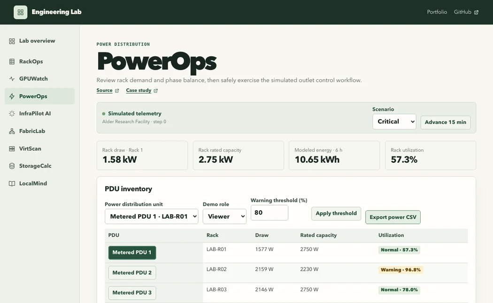
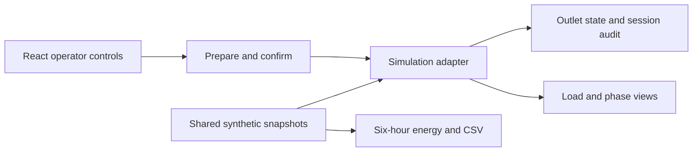

# PowerOps

PowerOps is a portfolio MVP for inspecting rack power and controlling simulated outlets. An outlet map connects equipment to labeled branch phases and ratings. Reports show instantaneous watts, kilowatts and modeled energy.

## Run and try

From the repository root, run `npm ci` and `npm run dev`, then open `http://localhost:5173/lab/powerops`. Select **Critical** to investigate the loaded PDU. Pick an outlet, choose the **Operator** demo role, and request an off or reboot action. Confirm in the dialog and check the audit history. A simulated reboot lasts three seconds.

Open **Simulate phase balancing** to compare current loads with a proposed assignment. The comparison greedily assigns the largest active loads to the least-loaded phase and preserves the total load. The plan is advisory. **Export power CSV** produces outlet and PDU readings with their warning threshold.

Run `node --test src/lab/apps/operations.test.mjs` to validate role enforcement, confirmation expiry, audit, reboot behavior and energy calculations. `npx playwright test tests/lab-operations.spec.js --project=chromium` exercises the confirmation flow in a browser.

## Architecture

React and Vite run the interface. The simulator adapter exposes inventory inspection, action preparation, cancellation, confirmation and audit. Energy is the sum of each scenario sample in kilowatt-hours over a 15-minute sample interval. Six-hour energy represents the baseline scenario replay. Instantaneous readings reflect simulated outlet overrides.

## Security and limits

Each command requires the Operator demo role, a known outlet and an unexpired single-use confirmation, with role and action checks repeated when the user confirms. The role switch and audit are browser-session demonstrations. A production adapter would need server-side identity, access control, vendor-specific protocol support and durable audit storage. The public project includes only the simulation adapter and cannot connect to PDU hardware.
