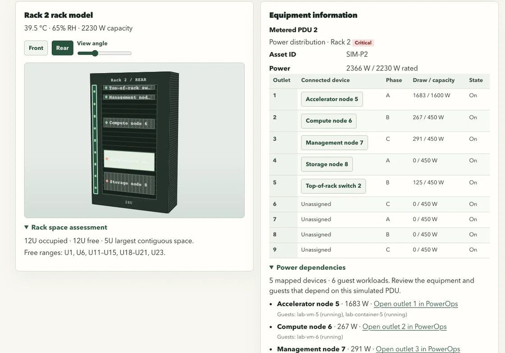
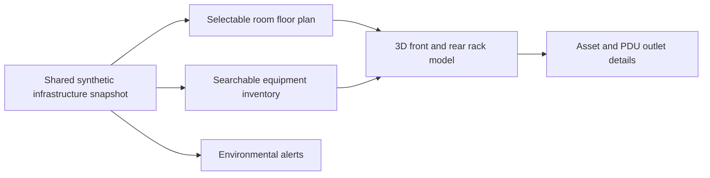

# RackOps

RackOps is a digital twin for fictional data centres. Choose a facility room, select a rack from the floor plan, and inspect equipment from the front and rear in a rotatable 3D rack. The rear includes vertical PDU strips with individually identified outlet states. The inventory supports type and health filters and search across all simulated facilities.

## Run

From the portfolio root, run `npm ci` and `npm run dev`, then open the engineering lab and choose RackOps. Select a warning or critical scenario in the lab controls to inspect synthetic environmental alerts. Run the domain tests with `node --test src/lab/apps/rack.test.mjs`.

## Architecture

React joins normalized racks, servers, switches, PDUs and environmental observations from the simulator. A CSS 3D transform renders the generic cabinet using rack-unit placement and a selectable viewing angle. The equipment model uses original HTML and CSS.

## Security and limits

The digital twin is read-only. Telemetry and inventory are fictional. The plan is schematic and the rack geometry illustrates unit placement, not dimensional or clearance compliance. PDU controls are available as separate simulated actions in PowerOps.

**Status** Functional browser MVP.
