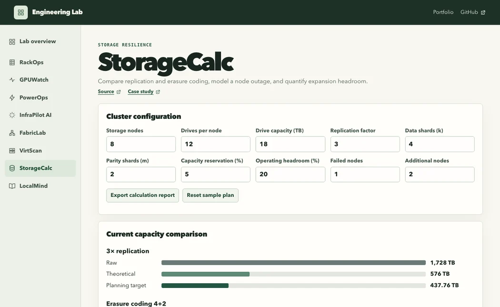
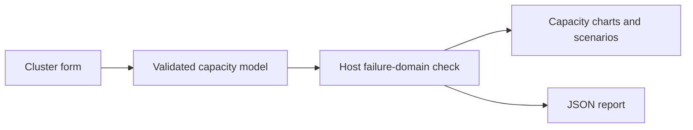

# StorageCalc

StorageCalc compares uniform-node replicated and erasure-coded storage designs. Its interactive inputs cover disk geometry, replication, erasure coding, reservations, operating headroom, failed nodes, and expansion. The chart and JSON export show theoretical capacity separately from planning capacity.

## Run

From the portfolio root, run `npm ci` and `npm run dev`, then open the engineering lab and select StorageCalc. Run the domain tests with `node --test src/lab/apps/storage.test.mjs`.

## Architecture

The React UI calls a deterministic JavaScript module. The initial sample contains eight fictional nodes with twelve 18 TB drives per node. Decimal TB uses 10¹² bytes and TiB uses 2⁴⁰ bytes.

Raw capacity multiplies node count, drives per node, and drive capacity. Replicated capacity divides by the replica count. Erasure-coded capacity multiplies by k/(k+m). Planning capacity applies the reserve percentage, then applies operating headroom to the remaining capacity. The model requires a distinct host for every replica or erasure shard. [Ceph erasure coding documentation](https://docs.ceph.com/en/tentacle/rados/operations/erasure-code/)

### Post-loss target sizing

Enter a planning target in TB or leave it blank to preserve the current capacity per layout. The sizing model uses a monotonic search to find the minimum installed node count, including the configured failed nodes. Each candidate must support full placement and meet the target after capacity reservation and operating headroom. The JSON report includes the minimum count, additional hosts, and whether the current plan meets the target.

With the sample geometry, one failed node and a 500 TB target, the model requires 11 installed hosts for 3-way replication and 7 for 4+2 erasure coding. Targets requiring more than 500 installed hosts are reported as beyond the planner’s range.

## Security and limits

The planner works in the browser with synthetic inputs. Reports are generated locally. It assumes uniform drives, balanced distribution, and one shard per host failure domain. Actual recoverability depends on placement, pool settings, recovery space, and cluster health. The model does not estimate placement-group imbalance, metadata overhead, recovery time, or workload performance.

**Status** Functional browser MVP.

## Verification

The domain test verifies the 500 TB sizing result, placement-only threshold, and out-of-range targets. The browser check verifies the 500 TB scenario through the exported JSON. These browser checks passed in Chromium, Firefox, and WebKit.
