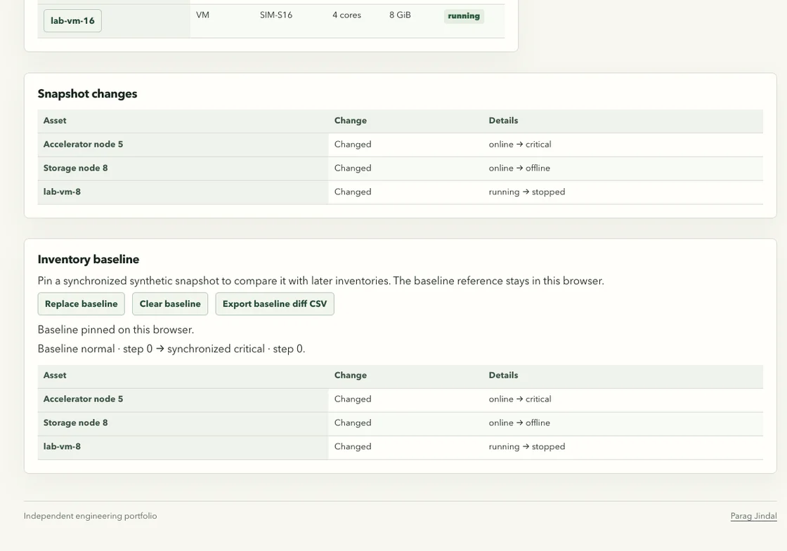
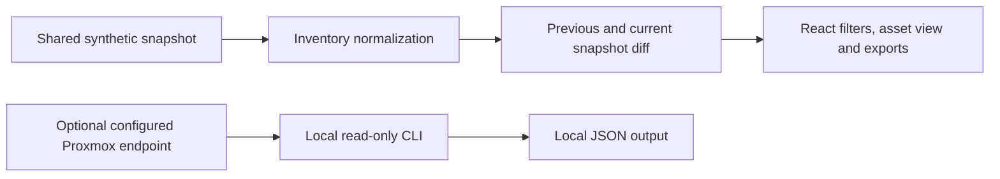

# VirtScan

VirtScan is a portfolio MVP for synchronizing and comparing read-only inventory snapshots. The app shows hosts, virtual machines and containers with hardware specifications, OS, synthetic network interfaces and lifecycle status.

## Run and try

From the repository root, run `npm ci` and `npm run dev`, then open `http://localhost:5173/lab/virtscan`. Switch from **Normal** to **Critical** and choose **Synchronize inventory**. Review host failures and stopped guests in **Snapshot changes**, filter by asset type or search by a synthetic address, then export the filtered view as JSON or CSV.

Run `node --test src/lab/apps/operations.test.mjs` for snapshot normalization, comparison, filtering and mocked API coverage. `npx playwright test tests/lab-operations.spec.js --project=chromium` exercises the browser workflow.

## Architecture

React and Vite run the public demo. The shared JavaScript simulation provides fixture records. Snapshot comparison reports additions, removals and changed fields by stable asset ID. **Pin current inventory** keeps a versioned synthetic scenario and step reference in this browser. Reopening the app reconstructs the baseline, and **Export baseline diff CSV** reports drift from the pinned inventory to the synchronized view. It compares inventory and lifecycle state and excludes utilization samples.

## Optional Proxmox inventory

Use an authorized lab cluster and a privilege-separated token scoped to read the relevant inventory. Set the variables in [the environment template](../../tools/proxmox-inventory.env.example) through your local secret environment and run `node tools/proxmox-inventory.mjs`. Use a locally trusted certificate or a private CA trusted by Node. The adapter requests the configured cluster's resources through one authenticated HTTPS GET, then returns hosts, QEMU guests, LXC containers and storage pools visible to the token. [Proxmox REST API browser](https://pve.proxmox.com/pve-docs/api-viewer/index.html) and [Proxmox VE administration guide](https://pve.proxmox.com/pve-docs/pve-admin-guide.pdf)

## Security and limits

The portfolio browser uses only synthetic inventory and does not accept live credentials or initiate network discovery. The local CLI keeps TLS validation enabled and rejects redirects to keep credentials at the configured origin. Real inventory may contain private asset names and must stay local. The single cluster-resource endpoint leaves OS details and network interfaces unavailable in the optional CLI output. Adapter tests use an in-memory HTTP response. Live API verification and persistent inventory history remain open.
