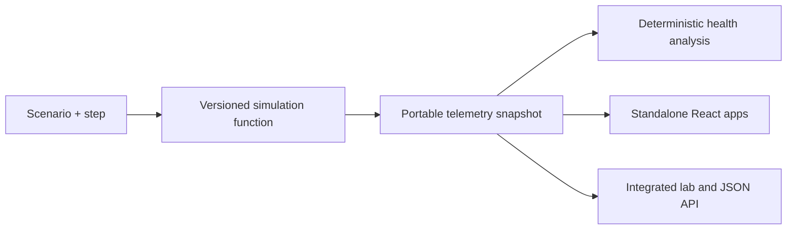

# Infrastructure Simulation

A versioned JavaScript library for deterministic telemetry and inventory of a fictional research facility. It runs in Node or a browser and has no runtime dependencies.

## Use the library

```sh
npm install ./infra-simulation-v2.0.0.tgz
```

```js
import { analyze, createSnapshot, history, SCENARIOS } from '@paragjindal01/infra-simulation';

const snapshot = createSnapshot({ scenario: 'critical', step: 6 });
const report = analyze(snapshot);
const series = history('recovery', 24);
console.log(SCENARIOS, report.alerts.length, series.length);
```

- `createSnapshot({ scenario, step })` returns the version 2 facility hierarchy, racks, servers, accelerators, PDUs, switches, workloads, and synthetic alerts.
- `history(scenario, steps)` generates 1–96 deterministic snapshots, sampled every 15 minutes.
- `analyze(snapshot)` validates the simulation schema version and returns counts, aggregate demand, and alert details.
- `SCENARIOS` contains `normal`, `warning`, `critical`, and `recovery`. `MAX_STEP` bounds snapshot steps.



The source archive includes its unit suite. Extract it and run `npm test` with Node 24 or later. The [portfolio simulation API](https://paragjindal.com/api/simulation?scenario=critical) uses this same engine contract.

All equipment, addresses, names, and measurements are synthetic. The library performs no network or hardware calls. Thresholds illustrate lab behavior. Keep the package version and snapshot schema separate when evolving this interface.

The package is marked private. A redistribution license has not been declared.
