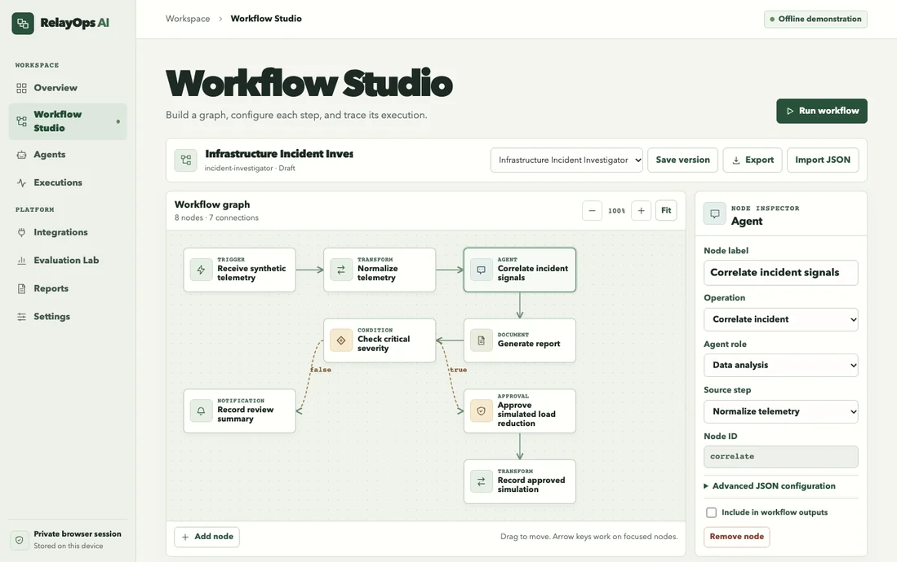
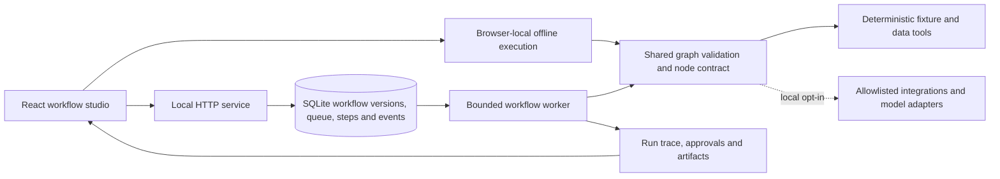
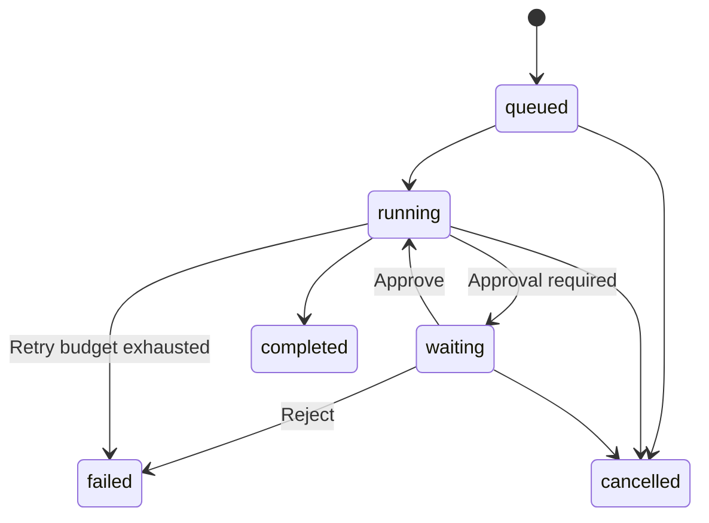

# RelayOps AI

RelayOps AI is a visual studio and durable local execution service for building and reviewing AI-assisted workflows. Compose bounded, typed graphs, run them against synthetic inputs, inspect every step, and evaluate the result from recorded evidence.

[Public offline demo](https://paragjindal.com/relayops/) · [API reference](docs/api.md) · [Security policy](SECURITY.md) · [Contributing](CONTRIBUTING.md)

## Studio and execution trace



[View the incident waiting for an approval](docs/screenshots/execution.webp).

## Flagship workflows

| Template | What it executes |
| --- | --- |
| GitHub Engineering Review | Reviews a bundled sample repository or explicitly connected public GitHub evidence, then produces prioritized findings pinned to source references |
| Autonomous Research Pipeline | Runs planning and sample-source collection in parallel, extracts evidence, validates citations, and generates a brief |
| Data Intelligence Analyst | Validates CSV or JSON, computes descriptive statistics and outliers, then exports a report and chart-ready data |
| Infrastructure Incident Investigator | Correlates synthetic thermal, load, power, and network evidence and requests approval before recording a simulated mitigation |

## Run locally

Requires Node.js 24 or later.

```sh
npm ci
npm run dev
```

Open `http://localhost:4371/relayops/` for the browser-local mode. Workflow versions and execution history live in this browser. Its scheduler runs in the browser and resumes interrupted eligible work on reload. The [public demo](https://paragjindal.com/relayops/) uses this mode with fixture data and deterministic offline operations.

### SQLite service

```sh
VITE_RELAYOPS_API=1 npm run build
npm start
```

Open `http://127.0.0.1:4174/relayops/`. The local service serves the UI and API on the same origin. Workflow versions, run state, execution steps, approvals and trace events are persisted in `data/relayops.sqlite`. `npm run benchmark` runs the five reproducible cases against this local service.

An equivalent offline-service setup is available with `docker compose up --build`. Compose publishes only a loopback port and keeps SQLite in a named volume. For Vite hot reload alongside the service, run `VITE_RELAYOPS_API=1 npm run dev` in a second terminal.

### Optional connected inference

Copy `.env.example` to `.env`, set `RELAYOPS_CONNECTED=1` and configure model names and credentials for the providers you intend to use. Start with `node --env-file=.env server/index.mjs`. The default service bind is loopback. Optional adapters support OpenAI, Anthropic, Gemini, Ollama and a loopback OpenAI-compatible endpoint. A model node can summarize scoped evidence. It has no tool or control access. Configure provider order, fallback and optional per-million-token pricing in the server environment. Pricing inputs determine estimates; confirm actual billing from the provider.

## Architecture





Graph validation rejects cycles, invalid branches, unknown operations, cross-node reference errors and unauthorized mitigation paths. The service schedules eligible independent nodes in parallel, bounds retries and timeouts, persists state transitions transactionally, and recovers queued work and pending approvals after restart. A replay can inspect an existing immutable trace or start a new execution from the original graph and input. Comparison and evaluation use actual run records.

## Test and release

```sh
npm test
npm run build
npx playwright install chromium
npm run test:browser
```

See [benchmark runs](docs/benchmark.md) for measured examples and [workflow API](docs/api.md) for automation. Tests cover isolated session tokens, approval gates, cancellation, restart recovery, retry behavior, bounded provider responses, reference validation, and safe network and file handling.

## Boundaries and roadmap

The hosted app is an offline demonstration. The durable service is a single-instance, SQLite-backed deployment intended for a local operator. Sessions are capabilities; multi-tenant identity, enterprise RBAC, redundant workers and backup automation are future work. Webhook triggers are graph input definitions with manual or API submission. The current release leaves inbound signed webhook delivery, real notifications, and external writes to later implementations. Research uses labeled sample sources. Public GitHub and the named public HTTP integration use fixed, read-only requests in connected mode. Provider adapter checks use mocked responses unless otherwise noted. No paid model account or infrastructure is required for the public or local offline workflows.
